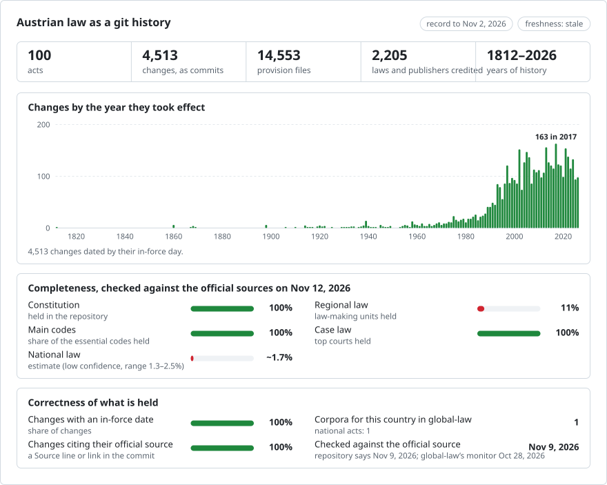

# Austria: law history in git

**English** · **[Oder auf Deutsch lesen](README.md)**

<picture>
<source media="(prefers-color-scheme: dark)" srcset="data/effort-dark.svg">

</picture>

The federal law of Austria as a git history: one file per provision (each §, article or annex), one commit per change on the day it took effect, and the law that made each change as the commit's author. `git blame` names the law behind every paragraph; `git log` lists every change to a provision; picking a date gives the text in force that day.

Part of [lexifina/global-law](https://github.com/lexifina/global-law), one git history for every country's law: this is Austria's federal law, which global-law reads at `austria/bund/acts/`.

**What is in it now:** the Federal Constitutional Law (B-VG) and 99 other federal acts and ordinances from the RIS, among them the ABGB, UGB, StGB, ZPO and ASVG, with 16,703 provisions in 46,113 versions, in 4,513 dated commits from 1812 to 2026-11-02. [`REPRODUCE.md`](REPRODUCE.md) lists every act with its Gesetzesnummer, provisions and versions; [`gesetze.csv`](gesetze.csv) lists every law that made a change, with the day it took effect.

Each act is a folder and each provision a file named after its RIS designation (`azg/par-0009.md` is § 9 of the Arbeitszeitgesetz, the Working Time Act; `b-vg/art-010.md` is Art. 10 B-VG); sections inside an article sit in its folder (`dsg/art-002/par-0024.md`). Each paragraph (Absatz) is one line.

The text is in German, as the RIS publishes it. An English translation is not part of this record.

## Questions as git commands

| Question | Command |
| --- | --- |
| Every change to § 9 of the Working Time Act | `git log -p --word-diff -- azg/par-0009.md` |
| Which law wrote each paragraph of § 9? | `git blame azg/par-0009.md` |
| Every version of the Working Time Act, with the day each took effect | `git log --format="%h %(trailers:key=In-force,valueonly,separator=) %an" -- azg` |
| § 9 as in force on 1 January 2018 | `python tools/stand_am.py 2018-01-01 azg 9` |

**Outside git**, we also host this record publicly, for free:

- **[Ask Claude about Austrian law](https://global-law.lexifina.com/v1/try_claude?country=austria)**: opens Claude with a first question ready.
- **[Ask ChatGPT](https://global-law.lexifina.com/v1/try_chatgpt?country=austria)**: the same question in ChatGPT.
- **[Call the API in your browser](https://global-law.lexifina.com/v1/search_law?query=Urlaub&jurisdictions=austria)**: a search of Austrian law for "Urlaub", returned as JSON. See the [documentation here](https://lexifina.com/api/global-law).

Both assistants read the record through the free Global law connector (MCP, `https://global-law.lexifina.com/mcp`); the first time, the chat gives you the link that adds it. Ask in German or in English.

**Host it yourself easily.** All it takes is git and Python, and the tools run on your machine:

```sh
git clone --depth 1 https://github.com/lexifina/global-law && cd global-law
python3 tools/countries.py add austria/bund/acts
python3 tools/law.py show 2026-01-01 austria/bund/acts/azg/par-0009.md
```

Opened in Claude Code, Cursor, VS Code or Codex, the clone also starts a local MCP server with the same tools ([MCP.md](https://github.com/lexifina/global-law/blob/main/MCP.md)).

## Dates

Each commit is dated at noon, Europe/Vienna, on the day the change took effect, and carries it in its `In-force:` trailer:

- for every version, its first day in the RIS (Inkrafttretensdatum); where a provision's last version ends (Ausserkrafttretensdatum) and no new one follows, its file is removed the next day;
- git cannot store dates before 1970, so the 212 earlier commits are dated from 1970-01-01, one second apart, with the real day in `In-force:`. Ask for a date with `tools/stand_am.py`, not `git log --before`;
- changes promulgated but not yet in force are on the branch `future`, never on `main`.

Each change is credited to the law the RIS names for the version ("zuletzt geändert durch", e.g. `BGBl. I Nr. 53/2018`), at an address ending `@ris.invalid`. Where the RIS names no law, the change is credited by date to the one law it names for versions of that act beginning that day (`Evidence: date only`). Otherwise, as for a version for which the RIS names the same law as for the one before, no law is credited: the commit is by `RIS (Bundeskanzleramt)` (585 of 4,513 commits), mostly naming the possible laws in `Candidate:` trailers.

## How it is checked

- `tools/check_repo.py` reads every version of every provision back from git on the day it took effect, and the version before on the day before, and compares both with the RIS text, byte for byte and word for word (the words read from the RIS document without the build's parser).
- `tools/test_repo.py` checks that blame names a law, that `stand_am.py` gives the text before and after an amendment, and that `git log --follow` lists the changes in date order.
- [`data/fassungen.json`](data/fassungen.json) lists every RIS document used, with the SHA-256 of its XML; [`REPRODUCE.md`](REPRODUCE.md) gives the commands that build and check it again.
- History is append-only: published commits are never rewritten. The 98 acts after the B-VG and DSG, built by MrKrojer as KLex-Austria ([lexifina/global-law#21](https://github.com/lexifina/global-law/issues/21)), were appended, not merged by date.

## What it does not show

- **Most federal law.** The 100 acts and ordinances are the Constitution, the main codes and the main acts of fields such as administrative, labour, social, tax, energy, environmental and transport law; the rest of the RIS's consolidated federal law is not here yet (`tools/build.py` takes any act by its Gesetzesnummer).
- **Text older than the RIS's history.** A provision starts with its first version in the RIS, often later than the act (§ 9 AZG from 1994, the act from 1969); before that its file is absent, which does not mean it was not law.
- **Which of two laws of one day** made a change, where the RIS does not say: those commits are by `RIS (Bundeskanzleramt)`.
- **Land law.** Burgenland's is in [austria-burgenland-law](https://github.com/lexifina/austria-burgenland-law); the other eight Länder are not held.
- **Case law, treaties and EU law** are not part of this repository.

## Sources

| Source | Kind | Past versions | Notes |
| --- | --- | --- | --- |
| [RIS](https://www.ris.bka.gv.at) (Rechtsinformationssystem des Bundes, Bundeskanzleramt), through its [OGD API v2.6](https://data.bka.gv.at/ris/api/v2.6/Bundesrecht) | Consolidated federal law (Bundesrecht konsolidiert) | yes, every version of every provision, with its first and last day | Names the amending law for each version; only the Bundesgesetzblatt is authentic |

## Licence

See [`LICENSE`](LICENSE). Laws are not protected by copyright in Austria (§ 7 Abs. 1 Urheberrechtsgesetz); the text and its metadata come from the RIS Open Government Data interface under CC BY 4.0, rearranged into one file per provision with white space normalised and no words changed:

> Quelle: Rechtsinformationssystem des Bundes (RIS), Bundeskanzleramt, https://www.ris.bka.gv.at, lizenziert unter CC BY 4.0 (https://creativecommons.org/licenses/by/4.0/deed.de).

The history, commit messages, tables and tools are released under CC0 1.0, as far as they are ours.

This repository is not legal advice and not an official publication.

## More

From [lexifina/global-law](https://github.com/lexifina/global-law):

- [FEATURES.md](https://github.com/lexifina/global-law/blob/main/FEATURES.md): every feature, and what every corpus must support (`git blame`, `law.py`, the MCP tools)
- [FAQ.md](https://github.com/lexifina/global-law/blob/main/FAQ.md): questions and answers · [CONTRIBUTING.md](https://github.com/lexifina/global-law/blob/main/CONTRIBUTING.md): proposing changes · [MCP.md](https://github.com/lexifina/global-law/blob/main/MCP.md): the MCP server · [REPRODUCE.md](https://github.com/lexifina/global-law/blob/main/REPRODUCE.md): how it was built · [CHANGELOG.md](https://github.com/lexifina/global-law/blob/main/CHANGELOG.md)
- [FRESHNESS.md](https://github.com/lexifina/global-law/blob/main/FRESHNESS.md): how current each corpus is · [Monitoring](https://github.com/lexifina/global-law/tree/main/monitoring): whether updates are running · [WATCHING.md](https://github.com/lexifina/global-law/blob/main/WATCHING.md): how each official source is watched for changes
- [performance/](https://github.com/lexifina/global-law/tree/main/performance): how fast the tools are, measured
- [visualisations/](https://github.com/lexifina/global-law/tree/main/visualisations): charts and bridges across the world's law
- [Vulnerabilities](https://github.com/lexifina/global-law/tree/main/vulnerabilities): mistakes in legislation as published
