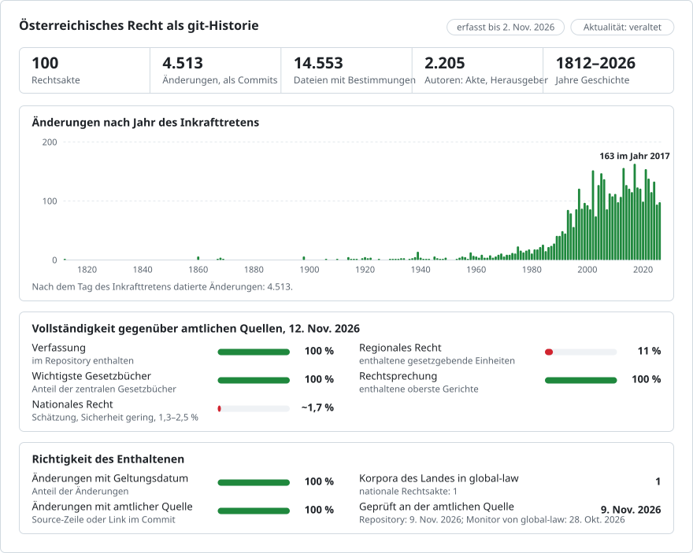

# Österreich: Rechtsgeschichte in Git

**Deutsch** · **[Or read it in English](README.en.md)**

<picture>
<source media="(prefers-color-scheme: dark)" srcset="data/de/effort-dark.svg">

</picture>

Das Bundesrecht Österreichs als Git-Historie: eine Datei je Bestimmung (jeder Paragraph, Artikel oder jede Anlage), ein Commit je Änderung an dem Tag, an dem sie in Kraft getreten ist, und als Autor des Commits das Gesetz, das die Änderung vorgenommen hat. `git blame` nennt zu jedem Absatz das Gesetz, das ihn geschrieben hat; `git log` listet jede Änderung einer Bestimmung auf; ein gewähltes Datum ergibt den an diesem Tag geltenden Text.

Teil von [lexifina/global-law](https://github.com/lexifina/global-law), einer Git-Historie für das Recht aller Länder: Dies ist das Bundesrecht Österreichs, das global-law unter `austria/bund/acts/` liest.

**Was es jetzt enthält:** das Bundes-Verfassungsgesetz (B-VG) und 99 weitere Bundesgesetze und Verordnungen aus dem RIS, darunter ABGB, UGB, StGB, ZPO und ASVG, mit 16.703 Bestimmungen in 46.113 Fassungen, in 4.513 datierten Commits von 1812 bis 2026-11-02. [`REPRODUCE.md`](REPRODUCE.md) führt jedes Gesetz mit Gesetzesnummer, Bestimmungen und Fassungen an; [`gesetze.csv`](gesetze.csv) führt jedes Gesetz, das eine Änderung vorgenommen hat, mit dem Tag seines Inkrafttretens an.

Jedes Gesetz ist ein Ordner und jede Bestimmung eine Datei, benannt nach ihrer Bezeichnung im RIS (`azg/par-0009.md` ist § 9 Arbeitszeitgesetz; `b-vg/art-010.md` ist Art. 10 B-VG); Paragraphen innerhalb eines Artikels liegen in dessen Ordner (`dsg/art-002/par-0024.md`). Jeder Absatz ist eine Zeile.

Der Text ist auf Deutsch, so wie ihn das RIS veröffentlicht. Eine englische Übersetzung ist nicht Teil dieses Bestands.

## Fragen als Git-Befehle

| Frage | Befehl |
| --- | --- |
| Jede Änderung von § 9 Arbeitszeitgesetz | `git log -p --word-diff -- azg/par-0009.md` |
| Welches Gesetz hat jeden Absatz von § 9 geschrieben? | `git blame azg/par-0009.md` |
| Jede Fassung des Arbeitszeitgesetzes, mit dem Tag ihres Inkrafttretens | `git log --format="%h %(trailers:key=In-force,valueonly,separator=) %an" -- azg` |
| § 9 in der am 1. Jänner 2018 geltenden Fassung | `python tools/stand_am.py 2018-01-01 azg 9` |

**Außerhalb von Git** stellen wir diesen Bestand auch öffentlich und kostenlos bereit:

- **[Claude zum österreichischen Recht fragen](https://global-law.lexifina.com/v1/try_claude?country=austria)**: öffnet Claude mit einer vorbereiteten ersten Frage.
- **[ChatGPT fragen](https://global-law.lexifina.com/v1/try_chatgpt?country=austria)**: dieselbe Frage in ChatGPT.
- **[Die API im Browser aufrufen](https://global-law.lexifina.com/v1/search_law?query=Urlaub&jurisdictions=austria)**: eine Suche im österreichischen Recht nach „Urlaub“, als JSON. Die Dokumentation finden Sie [hier](https://lexifina.com/api/global-law).

Beide Assistenten lesen den Bestand über den kostenlosen Connector Global law (MCP, `https://global-law.lexifina.com/mcp`); beim ersten Mal gibt Ihnen der Chat den Link, mit dem Sie ihn hinzufügen. Fragen Sie auf Deutsch oder auf Englisch.

**Ganz einfach selbst betreiben.** Sie brauchen nur Git und Python, und die Werkzeuge laufen auf Ihrem Rechner:

```sh
git clone --depth 1 https://github.com/lexifina/global-law && cd global-law
python3 tools/countries.py add austria/bund/acts
python3 tools/law.py show 2026-01-01 austria/bund/acts/azg/par-0009.md
```

In Claude Code, Cursor, VS Code oder Codex geöffnet, startet der Klon auch einen lokalen MCP-Server mit denselben Werkzeugen ([MCP.md](https://github.com/lexifina/global-law/blob/main/MCP.md)).

## Datumsangaben

Jeder Commit ist mit 12 Uhr Wiener Zeit (Europe/Vienna) des Tages datiert, an dem die Änderung in Kraft getreten ist, und trägt diesen Tag in seinem `In-force:`-Trailer:

- bei jeder Fassung ihr erster Tag im RIS (Inkrafttretensdatum); endet die letzte Fassung einer Bestimmung (Außerkrafttretensdatum) und folgt keine neue, wird ihre Datei am Tag danach entfernt;
- Git kann keine Daten vor 1970 speichern, daher sind die 212 früheren Commits ab 1970-01-01 datiert, jeweils eine Sekunde auseinander, mit dem tatsächlichen Tag in `In-force:`. Fragen Sie nach einem Datum mit `tools/stand_am.py`, nicht mit `git log --before`;
- kundgemachte, aber noch nicht in Kraft getretene Änderungen stehen im Zweig `future`, nie in `main`.

Jede Änderung wird dem Gesetz zugeschrieben, das das RIS für die Fassung nennt („zuletzt geändert durch“, etwa `BGBl. I Nr. 53/2018`), mit einer Adresse, die auf `@ris.invalid` endet. Nennt das RIS kein Gesetz, wird die Änderung nach dem Datum dem einen Gesetz zugeschrieben, das es für die an diesem Tag beginnenden Fassungen des Gesetzes nennt (`Evidence: date only`). Andernfalls, etwa bei einer Fassung, für die das RIS dasselbe Gesetz nennt wie für die vorherige, wird kein Gesetz zugeschrieben: Der Commit stammt von `RIS (Bundeskanzleramt)` (585 von 4.513 Commits) und nennt meist die in Frage kommenden Gesetze in `Candidate:`-Trailern.

## Wie geprüft wird

- `tools/check_repo.py` liest jede Fassung jeder Bestimmung am Tag ihres Inkrafttretens aus Git zurück, ebenso die vorherige Fassung am Vortag, und vergleicht beide mit dem Text im RIS, Byte für Byte und Wort für Wort (die Wörter des RIS-Dokuments ohne den Parser des Builds gelesen).
- `tools/test_repo.py` prüft, dass `git blame` ein Gesetz nennt, dass `stand_am.py` den Text vor und nach einer Änderung liefert und dass `git log --follow` die Änderungen in zeitlicher Reihenfolge auflistet.
- [`data/fassungen.json`](data/fassungen.json) führt jedes verwendete RIS-Dokument mit dem SHA-256 seines XML an; [`REPRODUCE.md`](REPRODUCE.md) enthält die Befehle, mit denen der Bestand neu erstellt und geprüft wird.
- Die Historie wird nur fortgeschrieben: Veröffentlichte Commits werden nie umgeschrieben. Die 98 Gesetze nach B-VG und DSG, von MrKrojer als KLex-Austria erstellt ([lexifina/global-law#21](https://github.com/lexifina/global-law/issues/21)), wurden angehängt, nicht nach Datum eingefügt.

## Was es nicht zeigt

- **Den Großteil des Bundesrechts.** Die 100 Gesetze und Verordnungen sind die Verfassung, die großen Kodifikationen und die wichtigsten Gesetze von Bereichen wie Verwaltungs-, Arbeits-, Sozial-, Steuer-, Energie-, Umwelt- und Verkehrsrecht; das übrige konsolidierte Bundesrecht des RIS ist noch nicht hier (`tools/build.py` nimmt jedes Gesetz über seine Gesetzesnummer auf).
- **Texte, die älter sind als die Historie des RIS.** Eine Bestimmung beginnt mit ihrer ersten Fassung im RIS, oft später als das Gesetz (§ 9 AZG ab 1994, das Gesetz von 1969); davor fehlt ihre Datei, was nicht bedeutet, dass sie nicht gegolten hat.
- **Welches von zwei Gesetzen desselben Tages** eine Änderung vorgenommen hat, wo das RIS es nicht sagt: Diese Commits stammen von `RIS (Bundeskanzleramt)`.
- **Landesrecht.** Das burgenländische Landesrecht liegt in [austria-burgenland-law](https://github.com/lexifina/austria-burgenland-law); die anderen acht Länder sind nicht enthalten.
- **Rechtsprechung, Staatsverträge und EU-Recht** sind nicht Teil dieses Repositorys.

## Quellen

| Quelle | Art | Frühere Fassungen | Anmerkungen |
| --- | --- | --- | --- |
| [RIS](https://www.ris.bka.gv.at) (Rechtsinformationssystem des Bundes, Bundeskanzleramt), über seine [OGD-API v2.6](https://data.bka.gv.at/ris/api/v2.6/Bundesrecht) | Bundesrecht konsolidiert | ja, jede Fassung jeder Bestimmung, mit ihrem ersten und letzten Tag | Nennt für jede Fassung das Änderungsgesetz; authentisch ist nur das Bundesgesetzblatt |

## Lizenz

Siehe [`LICENSE`](LICENSE). Gesetze genießen in Österreich keinen urheberrechtlichen Schutz (§ 7 Abs. 1 Urheberrechtsgesetz); Text und Metadaten stammen aus der Open-Government-Data-Schnittstelle des RIS unter CC BY 4.0, umgeordnet in eine Datei je Bestimmung, mit vereinheitlichtem Leerraum und ohne geänderte Wörter:

> Quelle: Rechtsinformationssystem des Bundes (RIS), Bundeskanzleramt, https://www.ris.bka.gv.at, lizenziert unter CC BY 4.0 (https://creativecommons.org/licenses/by/4.0/deed.de).

Die Historie, die Commit-Nachrichten, die Tabellen und die Werkzeuge werden, soweit sie von uns stammen, unter CC0 1.0 freigegeben.

Dies ist eine Übersetzung der englischen Fassung ([README.en.md](README.en.md)); bei Abweichungen gilt die englische Fassung.

## Mehr

Aus dem Repository [lexifina/global-law](https://github.com/lexifina/global-law) (auf Englisch):

- [FEATURES.md](https://github.com/lexifina/global-law/blob/main/FEATURES.md): alle Funktionen und was jedes Korpus unterstützen muss (`git blame`, `law.py`, MCP-Werkzeuge)
- [FAQ.md](https://github.com/lexifina/global-law/blob/main/FAQ.md): Fragen und Antworten · [CONTRIBUTING.md](https://github.com/lexifina/global-law/blob/main/CONTRIBUTING.md): Änderungen vorschlagen · [MCP.md](https://github.com/lexifina/global-law/blob/main/MCP.md): MCP-Server · [REPRODUCE.md](https://github.com/lexifina/global-law/blob/main/REPRODUCE.md): wie es erstellt wurde · [CHANGELOG.md](https://github.com/lexifina/global-law/blob/main/CHANGELOG.md)
- [FRESHNESS.md](https://github.com/lexifina/global-law/blob/main/FRESHNESS.md): wie aktuell jedes Korpus ist · [Überwachung](https://github.com/lexifina/global-law/tree/main/monitoring): ob die Aktualisierungen funktionieren · [WATCHING.md](https://github.com/lexifina/global-law/blob/main/WATCHING.md): wie jede amtliche Quelle auf Änderungen überwacht wird
- [performance/](https://github.com/lexifina/global-law/tree/main/performance): wie schnell die Werkzeuge sind, gemessen
- [visualisations/](https://github.com/lexifina/global-law/tree/main/visualisations): Diagramme und Verbindungen im Recht der ganzen Welt
- [Schwachstellen](https://github.com/lexifina/global-law/tree/main/vulnerabilities): Fehler in Rechtsakten, wie sie veröffentlicht wurden
