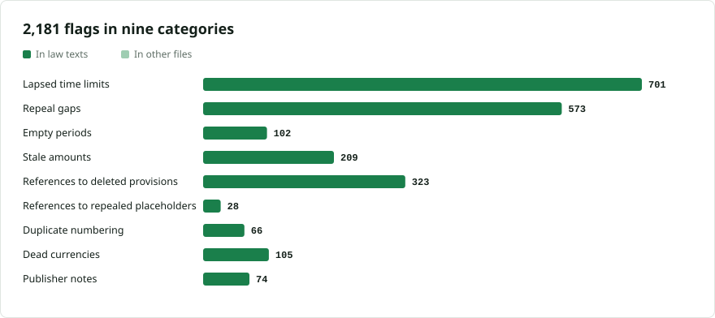

# Vulnerabilities in Austrian law

[Deutsch](README.md) · **English**

<picture>
<source media="(prefers-color-scheme: dark)" srcset="img/flags-by-category-dark.svg">

</picture>

The vulnerability detectors from [lexifina/global-law](https://github.com/lexifina/global-law/tree/main/vulnerabilities) look for mechanical mistakes in legislation: a rule applying "until" a date that has passed, a time limit extended only after it had run out, a provision repealed before its replacement took effect, an amount changed in one place but still standing in another, a reference to a section that no longer exists. global-law's published list (9 November 2026) covered Austria with 176 flags from an earlier copy of this repository that held only the B-VG and the DSG: 163 repeal gaps, 6 references to deleted provisions, 4 publisher notes (listed there as failed amendments) and 3 lapsed time limits. This is a run over this repository only, with all 100 acts and ordinances, as it stood at commit [`7b5e063`](https://github.com/lexifina/austria-law/commit/7b5e063477339218e6379a4e9a7b9ff11a6f3287) on 15 November 2026, with versions in force up to 2 November 2026. It finds the same 163 repeal gaps in the B-VG and 410 in the other acts, 701 lapsed time limits, 323 references to deleted provisions and 74 publisher notes, and five categories that list did not have for Austria: empty periods (102), stale amounts (209), references to repealed placeholders (28), duplicate numbering (66) and dead currencies (105). For this run the detectors were taught Austrian German: "Jänner", "bis zum Ablauf des 31. Dezember 2020", another act named after the section ("§ 221 Abs. 1 Z 2 UGB", "Art. 10 B-VG"), the schilling, and the RIS's own corrections ("(Anm.: richtig: ...)").

**In short:** the detectors raised 2,181 flags. A language model reviewed 200 of the strongest, arguing each one for and against; 32 survived. Checked by hand in this repository, two of them are real gaps: time limits extended only after they had run out, with no retroactive wording in the in-force rules this repository holds. The COVID-19 rule under which increases in the authorised capacity of waste storage sites only had to be notified (§ 37 Abs. 4a AWG 2002) covered increases "until 30.09.2020" and was extended to 30 April 2021 only from 8 January 2021 (BGBl. I Nr. 8/2021); the special COVID-19 rules for hearings and taking evidence in tax proceedings, hearings by video among them (§ 323c Abs. 4 BAO), applied "until the end of 31 December 2020" and were extended to 31 March 2021 only from 8 January 2021 (BGBl. I Nr. 3/2021). Both are long spent. Eight more come from how this repository is laid out: a file for an Artikel holds, one after another, the Artikel of that number of several amending acts (for the ASVG's Article II, those of 23 acts from 1956 to 1988), so the detector compared dates from different acts. Of the other 22, 2 are lawful, 3 are spent, 3 were misread by a detector and 14 are the same figure in an unrelated provision. Reading a category the model does not review, and the provisions around the flags, turned up three more likely drafting mistakes. § 8 Abs. 2 ÖSG 2012 still has the Landeshauptmann send the supply concepts of recognised plants "for the report under § 52 Abs. 1", which BGBl. I Nr. 150/2021 repealed from 28 July 2021. § 57g ÖSG 2012, the in-force rule of that amendment, cites the amendment and the Renewable Energy Expansion Act (EAG) twice each as "BGBl. I Nr. x/y". And § 124b Z 346 EStG 1988 repeals § 47 Abs. 1 lit. d "with the entry into force of the Finanz-Organisationsreformgesetz BGBl. I Nr. xx/2019", an act published as BGBl. I Nr. 104/2019 that takes effect on several dates; the RIS notes that 1 July 2020 is "obviously" meant. Later, this will be formalised in Lean, similar to our work on [the US tax code](https://lexifina.com/blog/formalizing-the-us-tax-code) and [US case law](https://lexifina.com/blog/formalizing-all-us-case-law-in-lean).

A flag is a prompt to look, not legal advice, and nothing here has been tested in court.

## Flags by category

| Category | What it looks for | Flags | In law texts | Reviewed | Survived review |
| --- | --- | ---: | ---: | ---: | ---: |
| Lapsed time limits | Text still applying a rule "until" a date that has passed | 701 | 701 | 40 | 2 |
| Repeal gaps | A provision removed before its replacement took effect | 573 | 573 | 40 | 0 |
| Empty periods | A time limit extended by an act that took effect after it had run out | 102 | 102 | 40 | 12 |
| Stale amounts | An amount changed in one place but still standing elsewhere | 209 | 209 | 40 | 14 |
| References to deleted provisions | A provision citing a section that no longer exists | 323 | 323 | 40 | 4 |
| References to repealed placeholders | A provision citing a section that now reads only "aufgehoben" | 28 | 28 | 0 | 0 |
| Duplicate numbering | Two units with the same number in one provision | 66 | 66 | 0 | 0 |
| Dead currencies | Amounts in currencies no longer in use | 105 | 105 | 0 | 0 |
| Publisher notes | The RIS's own notes on a slip in the text, and words such as "gegenstandslos" | 74 | 74 | 0 | 0 |

"In law texts" counts every file of the 100 acts and ordinances, so every flag is in a law text; only the root files, `data/` and `tools/` are not law, and none of them has a flag. Every provision is a file here, so the history detectors work as designed: a provision whose last version ends with no successor is a deleted file, and a section number used again for a new provision counts as a repeal gap. The commits carry the day each version took effect but not the day the amending act was published, so the search for retroactive dates has nothing to compare and found nothing, and the RIS keeps one version of a provision for each day, so there are no same-day conflicts either.

*Edge cases: the 32 flags that survived the review, grouped by what they turned out to be, the three likely mistakes found by reading, and what the other flags are, in [EDGE-CASES.en.md](EDGE-CASES.en.md).*

## Problems found in this repository

- **One file holds the Artikel of several amending acts:** the RIS gives the transitional and final articles of an amending act as articles of the act they amend ("Artikel II ... (Anm.: aus BGBl. Nr. 749/1988, zu BGBl. Nr. 189/1955)"), and this repository names each file by that designation, so one file takes the Article II of every amending act that has one, each replacing the last. 65 of the 512 Artikel files in this repository's history hold the Artikel of more than one amending act, 296 in all; [`asvg/art-002.md`](https://github.com/lexifina/austria-law/blob/7b5e063477339218e6379a4e9a7b9ff11a6f3287/asvg/art-002.md) holds the Article II of 23 amending acts of the ASVG, from BGBl. Nr. 266/1956 to BGBl. Nr. 749/1988 ([the last change](https://github.com/lexifina/austria-law/commit/35b0fb029f5d5a02ddf3be53864c26c1ca5174f0)). A later act's Article II does not repeal an earlier one's, but `git log` shows them as versions of one provision and the text for a date shows only the latest; eight of the empty periods that survived the review compare dates from two such acts ([Edge cases](EDGE-CASES.en.md)).

## Files

| File | What it holds |
| --- | --- |
| [data/flags.csv](data/flags.csv) | Every flag, one row per provision and issue |
| [data/reviewed.csv](data/reviewed.csv) | The 200 flags the model reviewed, with its verdict and reason |
| [data/by_category.csv](data/by_category.csv) | The counts in the table above |
| [tools/](tools/) | The scripts that made this run |

Columns: `category` and `category_de` (the category in English and German), `detector`, `kind` (`law` or `other`), `path` (the provision in this repository), `date` (the date the flag turns on), `reference` (the act or line involved), `summary`, `score` (the detector's ranking, 0 to 1), `review` (`artefact`, `lawful` or `candidate_defect`), `survives_rebuttal`, `review_note` (the model's reason, in English), `url` (the provision at the commit that was read, or, for a provision removed since, at the last commit that held it).

## How it was made

- **Detectors:** global-law's [vulnerabilities/scripts](https://github.com/lexifina/global-law/tree/main/vulnerabilities/scripts), with the fixes in [tools/patch_detectors.py](tools/patch_detectors.py) and the Austrian ones in [tools/patch_de.py](tools/patch_de.py), run on this repository at commit `7b5e063`. global-law replays this repository only up to an earlier commit, so the history table the detectors read was built from this repository's own commits (the law that made each change and its `In-force` date); all 4,513 commits with a date count as law. The Austrian fixes: the time-limit search reads "Jänner" and "Feber", "bis zum Ablauf des" and "bis einschließlich" (lapsed time limits went from 541 to 701, empty periods from 88 to 102); the reference search takes a section followed by another act's abbreviation or name ("§§ 10, 17 und 18 VStG", "Artikel 73 der Wechselordnung") as a reference to that act, "§§ 70 bis 75" as a range and "S. 28" after an Official Journal citation as a page, and skips the RIS's "(Anm.: ...)" notes (references to deleted provisions went from 495 to 323); the search for dead currencies knows the schilling, "Schilling" or "S" after an amount (1 flag became 105); and the search for publisher notes reads the RIS's "(Anm.: richtig ...)" (37 became 74).
- **Model review:** gpt-5.4-mini, the 40 strongest flags per category; every flag is in a law text, so the 40 strongest lapsed time limits in law texts are the same 40. One pass says whether a flag is real, a second argues that it is not. Empty periods use global-law's own review for that category, on the 11 flags whose old and new date open the same sentence and the 29 shortest of the rest, followed by the same second pass. The model does not review the last four categories. global-law's own list used a different model.
- **Hand check:** every flag that survived was read in this repository's history and texts, with the in-force rules of the extending act where this repository holds them (§ 91 AWG 2002, § 323 BAO, § 124b EStG 1988). All 28 references to repealed placeholders were read, as were the 74 publisher notes and samples of the other categories. The amending acts' own texts in the Bundesgesetzblatt were not read: the two open gaps and the three drafting mistakes still need the BGBl.

To report a correction, open an issue with the provision and an official source.

## Licence

The lists and notes are Lexifina's, dedicated to the public domain under CC0 1.0 like this repository's own history, tables and tools. Quoted law text is the RIS's (Rechtsinformationssystem des Bundes, Bundeskanzleramt), from its Open Government Data interface under CC BY 4.0: "Quelle: Rechtsinformationssystem des Bundes (RIS), Bundeskanzleramt, https://www.ris.bka.gv.at, lizenziert unter CC BY 4.0". Laws are not protected by copyright in Austria (§ 7 Abs. 1 Urheberrechtsgesetz), and only the Bundesgesetzblatt is authentic. See [LICENSE](../LICENSE).
