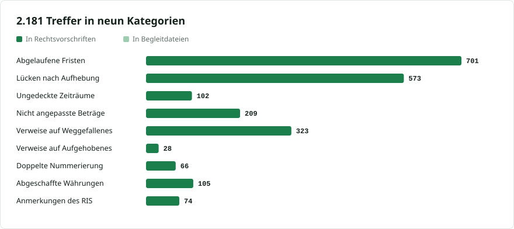

# Schwachstellen im österreichischen Recht

**Deutsch** · [English](README.en.md)

<picture>
<source media="(prefers-color-scheme: dark)" srcset="img/flags-by-category-dark.de.svg">

</picture>

Die Schwachstellen-Detektoren von [lexifina/global-law](https://github.com/lexifina/global-law/tree/main/vulnerabilities) suchen nach mechanischen Fehlern in der Gesetzgebung: eine Regelung, die „bis“ zu einem bereits verstrichenen Datum gilt, eine Frist, die erst nach ihrem Ablauf verlängert wurde, eine Bestimmung, die aufgehoben wurde, bevor ihre Nachfolgeregelung in Kraft trat, ein Betrag, der an einer Stelle geändert wurde und an einer anderen stehen blieb, ein Verweis auf einen Paragraphen, den es nicht mehr gibt. Die von global-law veröffentlichte Liste (9. November 2026) erfasste Österreich mit 176 Treffern aus einem früheren Stand dieses Repositoriums, der nur das B-VG und das DSG enthielt: 163 Lücken nach Aufhebung, 6 Verweise auf weggefallene Bestimmungen, 4 Anmerkungen (dort als gescheiterte Änderungen geführt) und 3 abgelaufene Fristen. Hier wurden die Detektoren nur über dieses Repositorium mit allen 100 Gesetzen und Verordnungen ausgeführt, und zwar auf dem Stand des Commits [`7b5e063`](https://github.com/lexifina/austria-law/commit/7b5e063477339218e6379a4e9a7b9ff11a6f3287) vom 15. November 2026, mit Fassungen, die bis zum 2. November 2026 in Kraft traten. Sie finden dieselben 163 Lücken nach Aufhebung im B-VG und 410 in den übrigen Gesetzen, 701 abgelaufene Fristen, 323 Verweise auf weggefallene Bestimmungen und 74 Anmerkungen des RIS sowie fünf Kategorien, die jene Liste für Österreich nicht hatte: ungedeckte Zeiträume (102), nicht angepasste Beträge (209), Verweise auf aufgehobene Bestimmungen (28), doppelte Nummerierung (66) und abgeschaffte Währungen (105). Für diesen Lauf lernten die Detektoren österreichisches Deutsch: „Jänner“, „bis zum Ablauf des 31. Dezember 2020“, ein anderes Gesetz, das nach dem Paragraphen genannt wird („§ 221 Abs. 1 Z 2 UGB“, „Art. 10 B-VG“), den Schilling und die Berichtigungen des RIS selbst („(Anm.: richtig: …)“).

**Kurz gesagt:** Die Detektoren lieferten 2.181 Treffer. Ein Sprachmodell prüfte die 200 stärksten und führte zu jedem Gründe dafür und dagegen an; 32 hielten stand. Von Hand in diesem Repositorium geprüft, sind zwei davon echte Lücken: Fristen, die erst nach ihrem Ablauf verlängert wurden, ohne Rückwirkung in den Inkrafttretensbestimmungen, die dieses Repositorium enthält. Die COVID-19-Regel, nach der eine Ausweitung der genehmigten Kapazität von Abfalllagern nur anzuzeigen war (§ 37 Abs. 4a AWG 2002), erfasste Ausweitungen „bis 30.09.2020“ und wurde erst ab 8. Jänner 2021 bis 30. April 2021 verlängert (BGBl. I Nr. 8/2021); die COVID-19-Sonderregelungen für Verhandlungen und Beweisaufnahmen im Abgabenverfahren, darunter Verhandlungen per Video (§ 323c Abs. 4 BAO), galten „bis zum Ablauf des 31. Dezember 2020“ und wurden erst ab 8. Jänner 2021 bis 31. März 2021 verlängert (BGBl. I Nr. 3/2021). Beide sind längst gegenstandslos. Acht weitere ergeben sich aus dem Aufbau dieses Repositoriums: Die Datei eines Artikels enthält nacheinander den gleichnamigen Artikel mehrerer Novellen (für Art. II ASVG jene von 23 Novellen aus den Jahren 1956 bis 1988), sodass der Detektor Daten verschiedener Gesetze verglich. Von den übrigen 22 sind 2 rechtmäßig, 3 gegenstandslos geworden, 3 von einem Detektor falsch gelesen und 14 derselbe Betrag in einer Bestimmung ohne Bezug. Die Durchsicht einer Kategorie, die das Modell nicht prüft, und der Bestimmungen rund um die Treffer ergab drei weitere wahrscheinliche Redaktionsfehler. § 8 Abs. 2 ÖSG 2012 verpflichtet den Landeshauptmann weiterhin, die Konzepte über die Rohstoffversorgung anerkannter Anlagen „zum Zweck der Erstellung des Berichts gemäß § 52 Abs. 1“ zu übermitteln, den BGBl. I Nr. 150/2021 mit 28. Juli 2021 aufhob. § 57g ÖSG 2012, die Inkrafttretensbestimmung eben dieser Novelle, zitiert die Novelle und das Erneuerbaren-Ausbau-Gesetz je zweimal als „BGBl. I Nr. x/y“. Und § 124b Z 346 EStG 1988 lässt § 47 Abs. 1 lit. d „mit Inkrafttreten des Finanz-Organisationsreformgesetzes BGBl. I Nr. xx/2019“ entfallen, eines Gesetzes, das als BGBl. I Nr. 104/2019 kundgemacht wurde und zu verschiedenen Zeitpunkten in Kraft trat; das RIS merkt an, gemeint sei „offensichtlich“ der 1.7.2020. Später wird dies in Lean formalisiert, ähnlich unserer Arbeit zum [US-Steuerrecht](https://lexifina.com/blog/formalizing-the-us-tax-code) und zur [US-Rechtsprechung](https://lexifina.com/blog/formalizing-all-us-case-law-in-lean).

Ein Treffer ist ein Anlass, genauer hinzusehen, keine Rechtsberatung, und nichts davon wurde vor Gericht erprobt.

## Treffer nach Kategorie

| Kategorie | Wonach gesucht wird | Treffer | In Rechtsvorschriften | Geprüft | Hielten stand |
| --- | --- | ---: | ---: | ---: | ---: |
| Abgelaufene Fristen | Text, der eine Regelung weiterhin „bis“ zu einem verstrichenen Datum anordnet | 701 | 701 | 40 | 2 |
| Lücken nach Aufhebung | Eine Bestimmung, die wegfiel, bevor ihre Nachfolgeregelung in Kraft trat | 573 | 573 | 40 | 0 |
| Ungedeckte Zeiträume | Eine Frist, verlängert durch ein Gesetz, das erst nach ihrem Ablauf in Kraft trat | 102 | 102 | 40 | 12 |
| Nicht angepasste Beträge | Ein Betrag, der an einer Stelle geändert wurde und an anderer Stelle stehen blieb | 209 | 209 | 40 | 14 |
| Verweise auf weggefallene Bestimmungen | Eine Bestimmung, die auf einen nicht mehr bestehenden Paragraphen verweist | 323 | 323 | 40 | 4 |
| Verweise auf aufgehobene Bestimmungen | Eine Bestimmung, die auf einen Paragraphen verweist, der nur noch „aufgehoben“ lautet | 28 | 28 | 0 | 0 |
| Doppelte Nummerierung | Zwei Gliederungseinheiten mit derselben Nummer in einer Bestimmung | 66 | 66 | 0 | 0 |
| Abgeschaffte Währungen | Beträge in Währungen, die nicht mehr gelten | 105 | 105 | 0 | 0 |
| Anmerkungen des RIS | Berichtigungen des RIS zu einem Fehler im Text und Wörter wie „gegenstandslos“ | 74 | 74 | 0 | 0 |

„In Rechtsvorschriften“ zählt jede Datei der 100 Gesetze und Verordnungen; daher steht jeder Treffer in einer Rechtsvorschrift. Nur die Dateien im Stammverzeichnis, `data/` und `tools/` sind kein Recht, und keine davon hat einen Treffer. Jede Bestimmung ist hier eine eigene Datei, sodass die Detektoren für die Historie wie vorgesehen arbeiten: Eine Bestimmung, deren letzte Fassung ohne Nachfolgerin endet, ist eine gelöschte Datei, und eine Paragraphennummer, die für eine neue Bestimmung wiederverwendet wird, zählt als Lücke nach Aufhebung. Die Commits tragen den Tag des Inkrafttretens jeder Fassung, aber nicht den Tag der Kundmachung des ändernden Gesetzes; die Suche nach rückwirkenden Daten hat daher nichts zu vergleichen und fand nichts. Das RIS führt je Bestimmung eine Fassung pro Tag, daher gibt es auch keine Änderungen am selben Tag.

*Grenzfälle: die 32 Treffer, die der Prüfung standhielten, gruppiert danach, als was sie sich erwiesen, die drei bei der Durchsicht gefundenen wahrscheinlichen Fehler und was die übrigen Treffer sind, in [EDGE-CASES.md](EDGE-CASES.md).*

## In diesem Repositorium festgestellte Probleme

- **Eine Datei enthält die Artikel mehrerer Novellen:** Das RIS führt die Übergangs- und Schlussbestimmungen einer Novelle als Artikel des geänderten Gesetzes („Artikel II … (Anm.: aus BGBl. Nr. 749/1988, zu BGBl. Nr. 189/1955)“), und dieses Repositorium benennt jede Datei nach dieser Bezeichnung. So nimmt eine Datei den Artikel II jeder Novelle auf, die einen hat, und jeder ersetzt den vorigen. 65 der 512 Artikel-Dateien in der Historie dieses Repositoriums enthalten die Artikel mehr als einer Novelle, insgesamt 296; [`asvg/art-002.md`](https://github.com/lexifina/austria-law/blob/7b5e063477339218e6379a4e9a7b9ff11a6f3287/asvg/art-002.md) enthält den Artikel II von 23 ASVG-Novellen, von BGBl. Nr. 266/1956 bis BGBl. Nr. 749/1988 ([die letzte Änderung](https://github.com/lexifina/austria-law/commit/35b0fb029f5d5a02ddf3be53864c26c1ca5174f0)). Der Artikel II einer späteren Novelle hebt den einer früheren nicht auf, doch `git log` zeigt sie als Fassungen einer einzigen Bestimmung, und der Text zu einem Stichtag zeigt nur den letzten; acht der ungedeckten Zeiträume, die der Prüfung standhielten, vergleichen Daten aus zwei solchen Novellen ([Grenzfälle](EDGE-CASES.md)).

## Dateien

| Datei | Inhalt |
| --- | --- |
| [data/flags.csv](data/flags.csv) | Jeder Treffer, eine Zeile je Bestimmung und Befund |
| [data/reviewed.csv](data/reviewed.csv) | Die 200 vom Modell geprüften Treffer, mit Urteil und Begründung |
| [data/by_category.csv](data/by_category.csv) | Die Zahlen der obigen Tabelle |
| [tools/](tools/) | Die Skripte dieses Laufs |

Spalten: `category` und `category_de` (die Kategorie auf Englisch und Deutsch), `detector`, `kind` (`law` oder `other`), `path` (die Bestimmung in diesem Repositorium), `date` (das Datum, auf das sich der Treffer bezieht), `reference` (das betroffene Gesetz oder die betroffene Zeile), `summary`, `score` (die Gewichtung des Detektors, 0 bis 1), `review` (`artefact`, `lawful` oder `candidate_defect`), `survives_rebuttal`, `review_note` (die Begründung des Modells, auf Englisch), `url` (die Bestimmung im gelesenen Commit oder, bei einer seither weggefallenen Bestimmung, im letzten Commit, der sie enthielt).

## Wie es gemacht wurde

- **Detektoren:** die [vulnerabilities/scripts](https://github.com/lexifina/global-law/tree/main/vulnerabilities/scripts) von global-law mit den Korrekturen in [tools/patch_detectors.py](tools/patch_detectors.py) und den österreichischen in [tools/patch_de.py](tools/patch_de.py), ausgeführt auf diesem Repositorium im Commit `7b5e063`. global-law spielt dieses Repositorium nur bis zu einem früheren Commit nach; die Tabelle der Historie, die die Detektoren lesen, wurde daher aus den eigenen Commits dieses Repositoriums gebildet (das Gesetz, das jede Änderung vornahm, und sein `In-force`-Datum); alle 4.513 datierten Commits gelten als Recht. Die österreichischen Korrekturen: Die Suche nach Fristen liest „Jänner“ und „Feber“, „bis zum Ablauf des“ und „bis einschließlich“ (abgelaufene Fristen von 541 auf 701, ungedeckte Zeiträume von 88 auf 102); die Suche nach Verweisen behandelt einen Paragraphen, auf den die Abkürzung oder der Name eines anderen Gesetzes folgt („§§ 10, 17 und 18 VStG“, „Artikel 73 der Wechselordnung“), als Verweis auf jenes Gesetz, „§§ 70 bis 75“ als Bereich und „S. 28“ nach einem Amtsblattzitat als Seite, und überspringt die Anmerkungen des RIS („(Anm.: …)“) (Verweise auf weggefallene Bestimmungen von 495 auf 323); die Suche nach abgeschafften Währungen kennt den Schilling, als „Schilling“ oder „S“ nach einem Betrag (von 1 auf 105 Treffer); die Suche nach Anmerkungen liest die Berichtigungen des RIS („(Anm.: richtig …)“) (von 37 auf 74).
- **Prüfung durch das Modell:** gpt-5.4-mini, die 40 stärksten Treffer je Kategorie; da jeder Treffer in einer Rechtsvorschrift steht, sind die 40 stärksten abgelaufenen Fristen in Rechtsvorschriften dieselben 40. Ein erster Durchgang beurteilt, ob ein Treffer echt ist, ein zweiter führt Gründe dagegen an. Für die ungedeckten Zeiträume dient die eigene Prüfung von global-law für diese Kategorie, an den 11 Treffern, deren altes und neues Datum denselben Satz eröffnen, und den 29 mit den kürzesten Lücken unter den übrigen, gefolgt vom selben zweiten Durchgang. Die letzten vier Kategorien prüft das Modell nicht. Die eigene Liste von global-law beruhte auf einem anderen Modell.
- **Prüfung von Hand:** Jeder Treffer, der standhielt, wurde in der Historie und den Texten dieses Repositoriums gelesen, samt den Inkrafttretensbestimmungen des verlängernden Gesetzes, soweit dieses Repositorium sie enthält (§ 91 AWG 2002, § 323 BAO, § 124b EStG 1988). Alle 28 Verweise auf aufgehobene Bestimmungen wurden gelesen, ebenso die 74 Anmerkungen und Stichproben der übrigen Kategorien. Die Texte der Novellen im Bundesgesetzblatt wurden nicht gelesen: Die zwei offenen Lücken und die drei Redaktionsfehler sind noch am BGBl. zu prüfen.

Korrekturen bitte als Issue mit der Bestimmung und einer amtlichen Quelle melden.

## Lizenz

Die Listen und Anmerkungen stammen von Lexifina und sind wie die Historie, die Tabellen und die Werkzeuge dieses Repositoriums unter CC0 1.0 gemeinfrei. Zitierter Gesetzestext stammt aus dem RIS (Rechtsinformationssystem des Bundes, Bundeskanzleramt), über dessen Open-Government-Data-Schnittstelle unter CC BY 4.0: „Quelle: Rechtsinformationssystem des Bundes (RIS), Bundeskanzleramt, https://www.ris.bka.gv.at, lizenziert unter CC BY 4.0“. Gesetze genießen in Österreich keinen urheberrechtlichen Schutz (§ 7 Abs. 1 Urheberrechtsgesetz), und authentisch ist allein das Bundesgesetzblatt. Siehe [LICENSE](../LICENSE).
